# State Graph EMPÍRICO — 3 Capas (inferido desde logs reales)

**Fuente**: 12 logs reales de ejecuciones del bot (`runs/test_*.log`)
**Eventos totales emitidos**: 628
**Eventos únicos observados**: 109 (de 233 definidos en código = **47% utilización**)
**Transiciones únicas observadas**: 147
**Método**: parser de logs `[slot1][HH:MM:SS] event {...}` + grafo direccional ponderado

> NO se ha usado el modelo previo como verdad. NO se han impuesto domains.
> Estados emergentes inferidos por **co-ocurrencia secuencial + frecuencia real**.

Datos crudos: `runs/state_graph_REAL_RUNTIME.json` (19.6 KB).

---

## CAPA 1 — FLOW REAL (principal)

### Estados emergentes inferidos (NO de diseño)

Inferidos por **co-ocurrencia secuencial estable en ≥3 runs**. 9 clusters emergentes:

| # | Cluster emergente | Eventos | Hits totales | Patrón |
|---|-------------------|--------:|------------:|--------|
| 1 | **profile_creation** | init → morelogin_fresh_created → profile_picked | 36 (3×12) | lineal, en TODOS los runs |
| 2 | **account_pick** | pick_account_tier → account_picked | 34 | lineal, 22 runs (incluye swaps) |
| 3 | **session_attach** | pre_flight_http → profile_started → cdp_version_ok → cdp_connected_ok → persona_created → headers_set → geo_set | 71 | lineal, 9-11 hits cada uno |
| 4 | **page_hydration** | shot → hydration_initial → hydration_done → cookies_post_hydration_accepted → cookies_post_hydration_final → page_state_detect | 54 | lineal, 9 runs llegaron aquí |
| 5 | **cart_stepper** | quick_mode → stepper_offer → qty (loop ×3) → click_find_tickets → find_tickets_clicked | 65 | denso, auto-loop en qty |
| 6 | **cart_continuar** | checkbox_acepto → click_continuar → continuar_clicked_js → continuar_ok | 32 | con retries |
| 7 | **login_flow** | login_start → no_email_input *(o)* email_typed → email_continuar_clicked → ... → pwd_typed | 60+ | con error branches |
| 8 | **recovery_cycle** | tm_forced_password_reset_detected → auto_recovery_start → recovery (loop ×3) → account_swap | 40+ | denso, auto-loop |
| 9 | **exit_cleanup** | stop_received → history_cleanup_inside → history_cleanup_finally → profile_closed → profile_auto_destroyed | ~15 | lineal terminal |

### Grafo Mermaid (flow REAL ponderado, top transiciones)

```mermaid
graph TD
    init["init<br/>(12x)"]
    profile_created["morelogin_fresh_created<br/>(12x)"]
    profile_picked["profile_picked<br/>(12x)"]
    pick_tier["pick_account_tier<br/>(22x)"]
    account_picked["account_picked<br/>(12x)"]
    account_swap["account_swap<br/>(10x)"]
    pre_flight["pre_flight_http<br/>(10x)"]
    profile_started["profile_started<br/>(11x)"]
    cdp_v["cdp_version_ok<br/>(11x)"]
    cdp_c["cdp_connected_ok<br/>(11x)"]
    persona["persona_created<br/>(10x)"]
    headers["headers_set<br/>(10x)"]
    geo["geo_set<br/>(10x)"]
    goto_evt["goto<br/>(9x)"]
    shot[("shot<br/>(58x)<br/>HUB")]
    hydr_init["hydration_initial<br/>(9x)"]
    hydr_done["hydration_done<br/>(9x)"]
    cookies_post["cookies_post_hydration_*<br/>(9+9x)"]
    page_state["page_state_detect<br/>(9x)"]
    quick_mode["quick_mode_via_best_available<br/>(9x)"]
    stepper["stepper_offer<br/>(9x)"]
    qty[("qty<br/>(27x)<br/>LOOP×3")]
    find_tickets["click_find_tickets<br/>(9x)"]
    ftc["find_tickets_clicked<br/>(9x)"]
    chk_acepto["checkbox_acepto<br/>(?)"]
    click_cont["click_continuar<br/>(18x)"]
    cont_js["continuar_clicked_js<br/>(?)"]
    cont_ok["continuar_ok<br/>(?)"]
    oauth["oauth_detected<br/>(?)"]
    login_start["login_start<br/>(18x)"]
    forced_reset["tm_forced_password_<br/>reset_detected<br/>(?)"]
    recovery[("recovery<br/>(16x)<br/>LOOP")]
    no_email["no_email_input<br/>(5x)"]
    fatal_block["FATAL_bot_block_early<br/>(?)"]
    stop["stop_received<br/>(?)"]
    cleanup["history_cleanup_finally"]
    profile_closed["profile_closed"]
    destroyed["profile_auto_destroyed"]

    %% SETUP cluster
    init -->|12x| profile_created
    profile_created -->|12x| profile_picked
    profile_picked -->|12x| pick_tier
    pick_tier -->|12x| account_picked
    pick_tier -.->|10x swap| account_swap
    account_picked -->|10x| pre_flight
    pre_flight -->|9x| profile_started
    profile_started -->|11x| cdp_v
    cdp_v -->|11x| cdp_c
    cdp_c -->|10x| persona
    persona --> headers
    headers -->|10x| geo

    %% Goto + browsing
    geo --> goto_evt
    goto_evt --> shot
    shot -->|9x| hydr_init
    hydr_init -->|9x| hydr_done
    hydr_done -->|9x| cookies_post
    cookies_post -->|9x| page_state
    page_state -->|9x| quick_mode
    quick_mode -->|9x| stepper
    stepper --> qty
    qty -->|18x loop| qty
    qty --> find_tickets
    find_tickets --> ftc
    ftc --> chk_acepto
    chk_acepto --> click_cont
    click_cont --> cont_js
    cont_js --> cont_ok

    %% Login + recovery
    cont_ok --> oauth
    oauth --> login_start
    login_start -.-> no_email
    login_start --> forced_reset
    forced_reset --> recovery
    recovery -->|13x loop| recovery
    forced_reset -.->|3x| shot

    %% Failure paths
    login_start -.-> fatal_block
    no_email -.-> fatal_block

    %% Exit
    fatal_block --> stop
    cont_ok --> stop
    stop --> cleanup
    cleanup --> profile_closed
    profile_closed --> destroyed

    classDef hub fill:#f96,stroke:#333,stroke-width:3px
    classDef loop fill:#ff6,stroke:#933,stroke-width:3px
    classDef terminal fill:#9c9,stroke:#363,stroke-width:2px
    classDef error fill:#f99,stroke:#933,stroke-width:2px
    class shot hub
    class qty,recovery loop
    class destroyed,cleanup terminal
    class fatal_block,no_email,no_pwd_input error
```



### Tabla — Estados emergentes con frecuencia REAL

| Cluster | Función enclosing | Eventos | Runtime hits | % del total |
|---------|-------------------|--------:|-------------:|------------:|
| (mezcla) `main` | `main()` | 63 | **382** | 60.8% |
| `shoot` (telemetría cross-cutting) | `shoot` | 2 | **59** | 9.4% |
| Eventos dinámicos (bridge) | `<dynamic>` | 11 | 44 | 7.0% |
| `login_full` flow | `login_full()` | 7 | 40 | 6.4% |
| `login_with_account_swap` flow | `login_with_account_swap()` | 12 | 37 | 5.9% |
| `pick_account` flow | `pick_account()` | 1 | 22 | 3.5% |
| `_rec_log` (recovery internal) | `_rec_log` (callback) | 1 | 16 | 2.5% |
| `pick_morelogin_profile` flow | `pick_morelogin_profile()` | 1 | 12 | 1.9% |
| `fill_card` flow | `fill_card()` | 7 | 7 | 1.1% |
| `handle_pre_checkout_step` | `handle_pre_checkout_step()` | 2 | 7 | 1.1% |
| `_check_bot_block` / `_early_bot_check` | helpers | 2 | 2 | 0.3% |

### Matriz top-20 transiciones REALES (con frecuencia)

| Rank | From | To | Weight | Patrón |
|-----:|------|----|------:|--------|
| 1 | `qty` | `qty` | **18** | self-loop stepper (3 qty per run × 6 runs) |
| 2 | `recovery` | `recovery` | **13** | self-loop recovery cycle (3 cycles × 4 runs) |
| 3 | `init` | `morelogin_fresh_created` | 12 | inicio canónico |
| 4 | `morelogin_fresh_created` | `profile_picked` | 12 | profile creation chain |
| 5 | `profile_picked` | `pick_account_tier` | 12 | account picker |
| 6 | `pick_account_tier` | `account_picked` | 12 | account selection |
| 7 | `profile_started` | `cdp_version_ok` | 11 | CDP attach |
| 8 | `cdp_version_ok` | `cdp_connected_ok` | 11 | CDP ready |
| 9 | `account_picked` | `pre_flight_http` | 10 | IP check |
| 10 | `cdp_connected_ok` | `persona_created` | 10 | stealth setup |
| 11 | `headers_set` | `geo_set` | 10 | geo setup |
| 12 | `pick_account_tier` | `account_swap` | **10** | swap branch (alternativa frecuente) |
| 13 | `pre_flight_http` | `profile_started` | 9 | flow main |
| 14 | `shot` | `hydration_initial` | 9 | screenshot ubicuo + hydration |
| 15 | `hydration_initial` | `hydration_done` | 9 | page hydration |
| 16 | `hydration_done` | `cookies_post_hydration_accepted` | 9 | cookies post |
| 17 | `cookies_post_hydration_accepted` | `cookies_post_hydration_final` | 9 | cookies done |
| 18 | `cookies_post_hydration_final` | `page_state_detect` | 9 | state detect |
| 19 | `page_state_detect` | `quick_mode_via_best_available` | 9 | quick mode |
| 20 | `quick_mode_via_best_available` | `stepper_offer` | 9 | stepper open |

**Observación crítica**: `qty → qty` (18x) y `recovery → recovery` (13x) son los **dos loops MÁS USADOS** del bot. Cualquier modelo que no los exprese pierde información.

---

## CAPA 2 — DIVERGENCIA MODELO vs REALIDAD

### Comparativa con el modelo v2 (5 estados: SETUP, BROWSING, LOGIN, CHECKOUT, EXIT)

#### A) "False states" del modelo (declarados, sin uso real)

Ningún estado v2 está vacío de eventos reales — todos tienen >0 hits. **NO hay false states a nivel macro**.

PERO sí hay **funciones enclosing del código que NUNCA se ejecutaron** en los 12 runs:

| Función código (asociada al modelo) | Estado v2 | Runtime hits | Observación |
|-------------------------------------|-----------|-------------:|-------------|
| `fill_card_adyen` | CHECKOUT | **0** | 12 runs y NINGUNO llegó a Adyen iframe (todos murieron antes en login o bot_block) |
| `handle_partners_seguro_step` | CHECKOUT | **0** | mismo motivo |
| `handle_separated_seats_modal` | BROWSING | **0** | seatmap mode no usado en runs |
| `select_seatmap_sections` | BROWSING | **0** | quick_mode only |
| `imap_otp` | LOGIN | **0** | OTP no requerido en los runs (recovery via reset password, no OTP) |
| `_acquire_pick_mutex` | SETUP | **0** | no se loggea (lock interno) |
| `_persist_bot_block` | EXIT | **0** | bot_block sí se loggeó pero desde main, no esta función |

**Conclusión**: el modelo v2 declara estados que sí se usan a nivel macro, pero **el 47% de eventos del código nunca se emite** porque algunas ramas/funciones no se ejecutaron en estos 12 runs.

#### B) "Missing states" — clusters reales NO representados en el modelo v2

Estos son sub-clusters densos REALES que v2 esconde dentro de SETUP/BROWSING/CHECKOUT:

| Sub-cluster REAL | Eventos | Hits | Modelo v2 lo mete en | Pérdida de granularidad |
|------------------|--------:|-----:|---------------------|------------------------|
| **`account_picker_loop`** (pick_tier→account_picked + swap loop) | 2 | 34 | LOGIN | account_swap es loop crítico, no se observa |
| **`session_attach_chain`** (CDP+stealth+geo, lineal 7 eventos) | 7 | 71 | SETUP | secuencia consistente que merece sub-estado |
| **`page_hydration_chain`** (shot→hydration→cookies→state_detect, 6 eventos) | 6 | 54 | BROWSING | patrón estable de inicio de pagina |
| **`stepper_qty_loop`** (qty→qty 18x) | 1 | 27 | BROWSING | LOOP CRÍTICO oculto, no estaba en LOOPS_ALLOWED de BROWSING en v2 |
| **`recovery_inner_loop`** (recovery×N + account_swap) | 2 | 26 | LOGIN | loop documentado pero su densidad real es alta |
| **`exit_cleanup_chain`** (stop_received→history_cleanup→profile_close→destroy) | 4 | ~15 | EXIT | secuencia lineal terminal merece sub-flow |

**Hallazgo crítico**: `qty → qty` loop NO está en LOOPS_ALLOWED de v2 (BROWSING está en LOOPS pero solo por click_continuar). El **stepper qty++ es un loop separado** que v2 fusiona pero la realidad lo distingue.

#### C) Transiciones del modelo v2 que NUNCA ocurren en runs reales

| Transición declarada en v2 | Frecuencia real | Estado |
|---------------------------|----------------:|--------|
| LOGIN → BROWSING (post-recovery) | **0** | nunca observada |
| CHECKOUT → LOGIN (mid-flow re-auth) | **0** | nunca observada |
| SETUP → EXIT directo (fatal early) | **0** | observado pero como path raro (FATAL_no_profile = 0 hits reales) |
| BROWSING → EXIT directo (sin LOGIN ni CHECKOUT) | **0** | siempre se intenta login antes de exit |

**Estas transiciones están en la matriz de v2 pero los 12 runs no las dispararon.** Pueden ser válidas teóricamente o ser "future-proofing" innecesario.

#### D) Eventos en runs NO definidos en código (11 dinámicos)

```
- (vienen del bridge `_compra_logger.log_event` con event names emitidos dinámicamente
   o desde otros módulos importados como account_recovery, queue_monitor, etc.)
```

Significado: el bridge captura eventos de OTRAS funciones (no solo `_compra_parallel.log`). Esto **valida que el shadow logging es útil**: ve más que el `log()` legacy.

---

## CAPA 3 — HOTSPOTS

### Loops REALES (no teóricos)

| Loop | Frecuencia | Significado |
|------|-----------:|-------------|
| **`qty → qty`** | **18x** | stepper qty++ 3 veces por run × 6 runs |
| **`recovery → recovery`** | **13x** | recovery cycle interno 3 ciclos × ~4 runs con forced_reset |
| **`shot ↔ tm_forced_password_reset_detected`** | 3x/3x | screenshot + reset detect cycle |
| `shot ↔ session_recovered_re_navigating_event` | 1x/1x | edge case raro |
| `shot ↔ guardar_continuar_clicked` | 1x/1x | edge case |
| `shot ↔ card_fields_filled` | 1x/1x | edge case |

**`shot` es un nodo "puente" universal** (58 hits = ubicuo). Aparece después de muchas operaciones críticas como telemetría.

### Hubs del grafo (out-degree ponderado)

| Hub | Out-weight | In-weight | freq | Rol |
|-----|----------:|----------:|----:|-----|
| `shot` | 58 | 58 | 58 | **nodo más conectado del bot** — telemetría ubicua |
| `qty` | 27 | 27 | 27 | epicentro del stepper loop |
| `pick_account_tier` | 22 | 22 | 22 | router de elección de cuenta (con swap branch) |
| `click_continuar` | 18 | 18 | 18 | router de retry de Continuar |
| `recovery` | 15 | 16 | 16 | epicentro recovery loop |
| `login_start` | 13 | 18 | 18 | entry point del login flow |
| `init` | 12 | 0 | 12 | ENTRY ABSOLUTO (12 runs = in-degree 0) |
| `morelogin_fresh_created`, `profile_picked`, `account_picked` | 12 cada uno | 12 | 12 | cadena profile creation |
| `profile_started`, `cdp_version_ok`, `cdp_connected_ok` | 11 cada uno | 11 | 11 | cadena CDP attach |

### Error sources (transiciones a FATAL_*/_err/bot_block)

| Source node | Transiciones a error | Comentario |
|-------------|--------------------:|------------|
| `find_tickets_clicked` | 2x | retry tras find_tickets_js_err |
| `email_continuar_clicked` | 1x | error post-typo |
| `tm_forced_password_reset_detected` | 1x | path de error post-reset |
| `pwd_continuar_clicked` | 1x | typing error en password |
| `otp_pasted` | 1x | OTP paste fail |
| `otp_submit_clicked` | 1x | OTP submit fail |
| `fill_card_inputs_filled` | 1x | error post fill card |
| `province_option_clicked` | 1x | province combobox error |
| `province_combobox_not_found` | 1x | province no encontrado |
| `guardar_continuar_clicked` | 1x | error post guardar |

### Donde el bot SE ROMPE más

**Frequencia de eventos de error / bloqueo en 12 runs**:

| Error/block event | Hits | Significado |
|-------------------|----:|-------------|
| `no_email_input` | **5** | login form no renderiza → bot_block en /auth |
| `FATAL_bot_block_early` | ~3 | bloqueo post-login en pre_checkout |
| `tm_forced_password_reset_detected` | múltiple | TM exige reset password (recovery flow) |
| `BAD_CREDENTIALS_detected` | 1 | TM rechaza email-password |
| `email_continuar_err` / `pwd_continuar_err` | 1 cada | typing failures aislados |

### Puntos de divergencia del flow esperado

**Branch crítica observada**: `pick_account_tier`
- En 12 hits, **10 disparan `account_swap`** (83%).
- Significa: la mayoría de runs requieren cambiar de cuenta al menos una vez.
- El modelo v2 esconde esto dentro de LOGIN.

**Otra branch crítica**: `login_start`
- Diverge a `email_typed` (path normal) o `no_email_input` (path bloqueado).
- 5 de los runs cayeron en `no_email_input` → el form NO se renderizó → bot_block.

### Estados terminales reales observados

| Estado terminal | Hits | Razón |
|----------------|----:|-------|
| `profile_auto_destroyed` | ~10 | cleanup OK al final |
| `FATAL_bot_block_early` | ~3 | bot_block en pre_checkout |
| `READY_FOR_USER` | 2 | runs exitosos que llegaron a tarjeta autorrellenada |
| `card_fields_filled` | 1 | precursor a READY_FOR_USER |

**Conclusión**: de 12 runs, **2 alcanzaron READY_FOR_USER** (16% éxito), 3 fueron bot_block (25%), el resto murió en login (recovery, account_swap exhausted, o no_email_input).

---

## RESUMEN PARA DECISIÓN

### Métricas globales

| Métrica | Valor |
|---------|------:|
| Eventos definidos en código | 233 |
| Eventos observados en runs reales | **109** |
| Eventos código nunca emitidos (dead-code) | 135 (57.9%) |
| Eventos en runs no en código (dinámicos via bridge) | 11 |
| Total eventos emitidos en 12 runs | 628 |
| Transiciones únicas observadas | 147 |
| **Runs analizados** | **12** |
| Runs exitosos (READY_FOR_USER) | 2 (16%) |
| Runs bloqueados (bot_block) | 3 (25%) |
| Runs muertos en login | 7 (58%) |

### El modelo v2 (5 estados) es:

- ✅ **Macro-consistente** con la realidad (estados sí se usan)
- ⚠️ **Pierde granularidad en 4 sub-clusters reales**:
  - account_picker_loop (con swap branch crítica)
  - session_attach_chain (7 eventos lineales 71 hits)
  - page_hydration_chain (6 eventos 54 hits)
  - stepper_qty_loop (18 hits, LOOP no declarado en v2)
- ⚠️ **Declara 4 transiciones que nunca ocurren** (LOGIN→BROWSING, CHECKOUT→LOGIN, SETUP→EXIT directo, BROWSING→EXIT directo)
- ❌ **No expresa `qty → qty` como loop** (el segundo loop más frecuente del bot)

### Datos crudos para auditoría

- `runs/state_graph_REAL_RUNTIME.json` — 19.6 KB, contiene todas las transiciones con peso real, hubs, ciclos, clusters
- `_state_graph_from_real_logs.py` — script reproducible

### Decisión sugerida (NO impuesta)

🟡 **El modelo v2 es correcto a nivel macro PERO esconde 4 sub-clusters reales relevantes para observabilidad**.

Tres opciones:
1. **Mantener v2 (5 estados)** y aceptar la pérdida de granularidad (decisión de diseño).
2. **Añadir sub-estados** dentro de los 5 macro-estados (account_picker, page_hydration, stepper, recovery_internal). Esto NO añade nuevos estados al FSM principal, solo categorías de observabilidad.
3. **Documentar los 4 sub-clusters como "patrones observables"** sin tocar el FSM. Solo enriquecer la telemetría con `subcluster` field en el payload.

**Mi recomendación (basada en datos, no opinión)**: opción 3. El modelo de 5 estados sigue siendo el correcto. Los sub-clusters son patrones de telemetría, no estados de control. Añadir `subcluster` al payload del log preserva información sin inflar el FSM.

---

## ARTEFACTOS GENERADOS (NO commiteados)

```
_state_graph_inference.py            (análisis estructural desde AST)
_state_graph_from_real_logs.py       (análisis empírico desde logs reales)
runs/state_graph_inference.json      (grafo estructural 221 transitions weight=1)
runs/state_graph_REAL_RUNTIME.json   (grafo empírico real 147 transitions weighted)
STATE_GRAPH_EMPIRICAL_3LAYERS.md     (este documento)
```

NO se modificó el bot. NO se commiteó nada.
